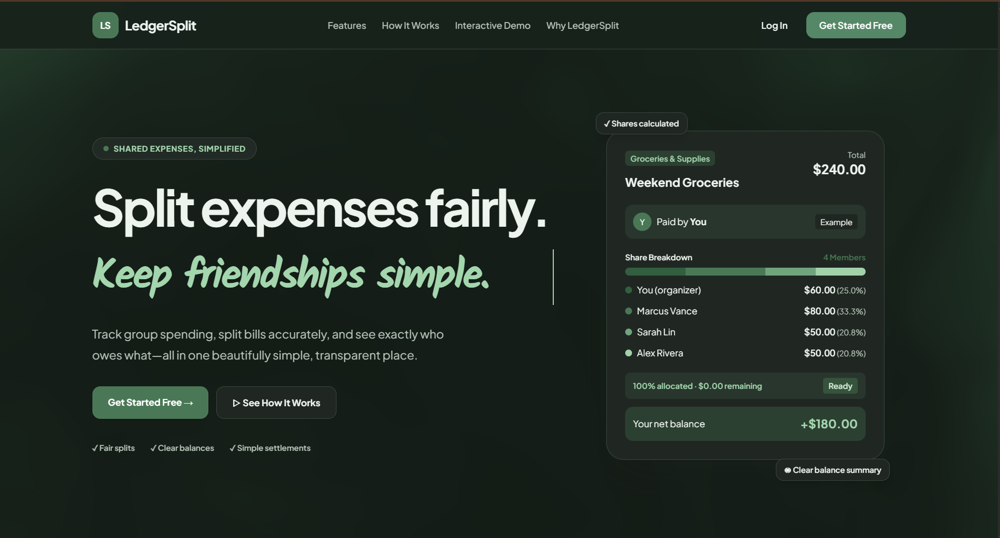
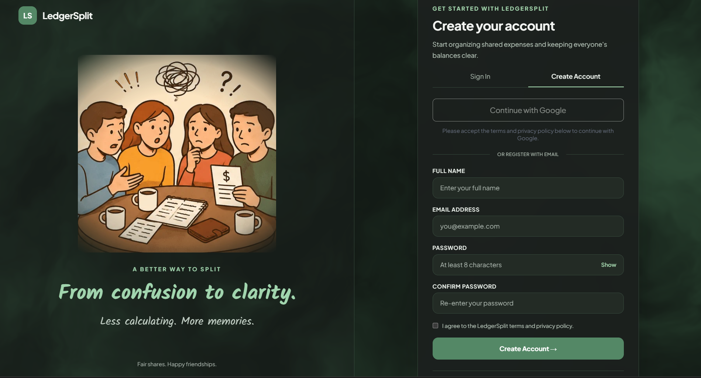
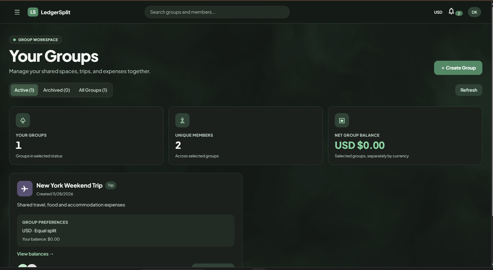
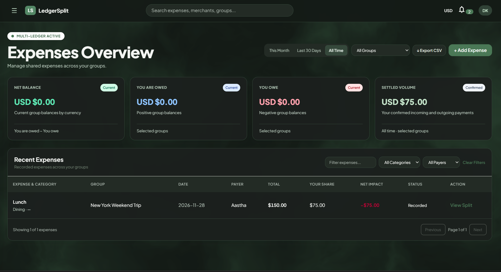
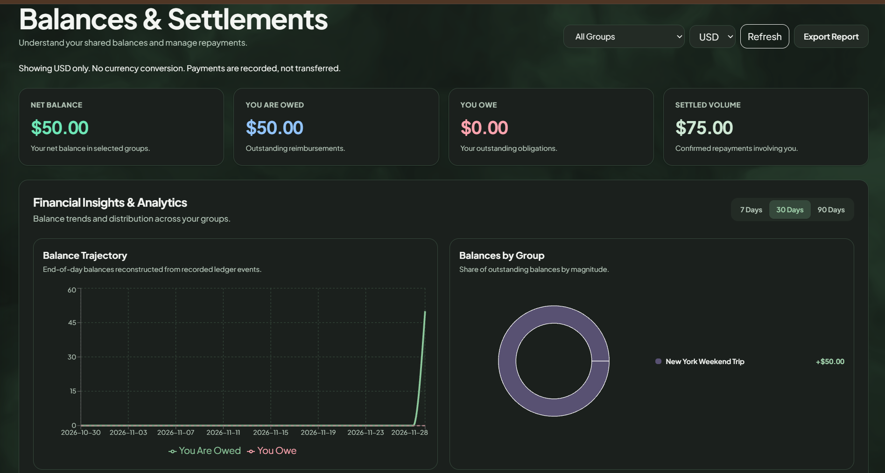
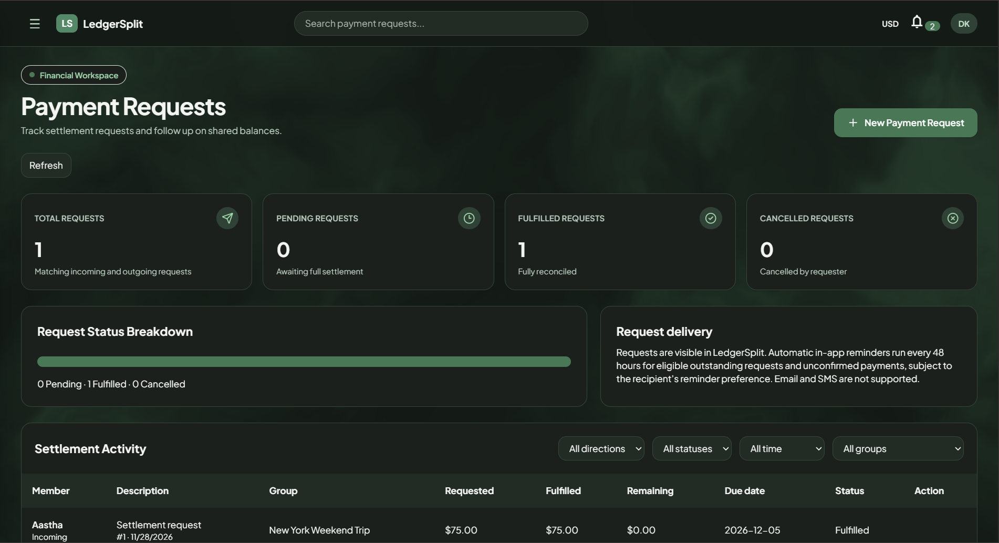
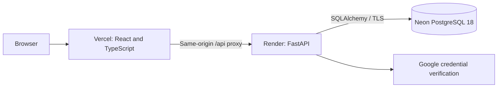
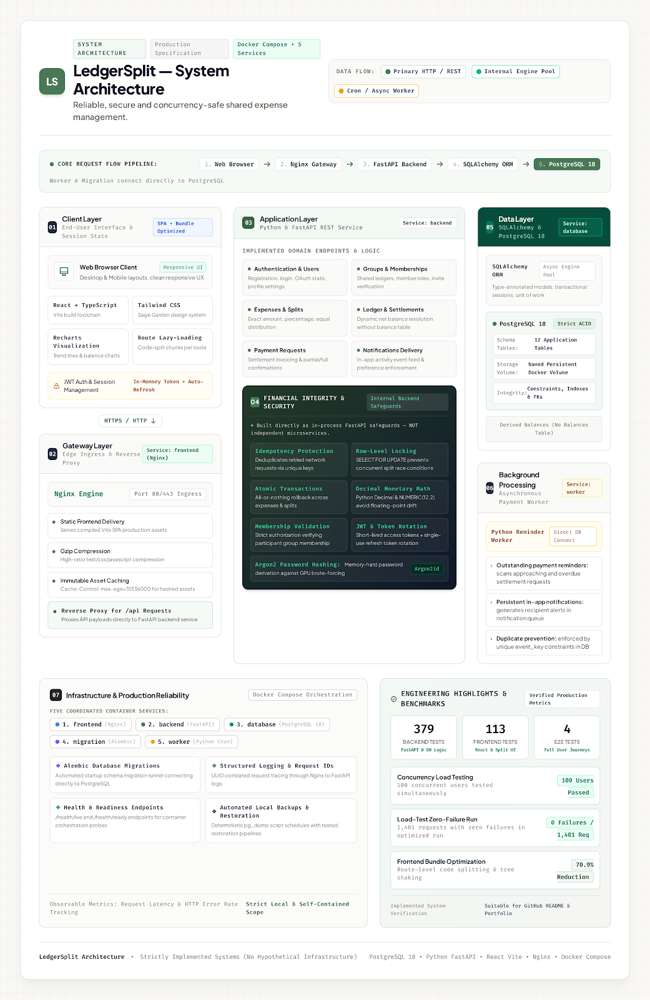
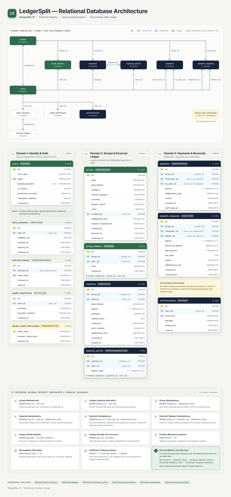

# LedgerSplit

**A concurrency-safe, full-stack shared expense management and financial ledger platform.**

[](https://ledgersplit-psi.vercel.app)   

**[Open the live website](https://ledgersplit-psi.vercel.app)** · [API readiness](https://ledgersplit-psi.vercel.app/api/health/ready)



## Overview

Shared expenses can become difficult to reconcile when multiple people record transactions, retry requests or settle debts simultaneously. LedgerSplit addresses this problem with a transactional PostgreSQL-backed ledger, explicit settlement confirmation and database-level concurrency controls.

The application records external repayments; it does not transfer money or integrate with a payment processor.

## Features

- Email/password authentication, Google OAuth, account linking and rotating refresh-token sessions.
- Shared groups, memberships, custom categories, archiving and controlled deletion.
- Equal, exact and percentage expense splits, with currency-aware monetary calculations.
- Derived balances, suggested settlements and historical balance visualization.
- Payment requests, repayment reporting, recipient confirmation and rejection.
- Persistent in-app notifications and a local background reminder worker.
- Responsive light and dark themes, profile settings and route-based lazy loading.

## Screenshots

### Authentication


### Groups


### Expenses


### Balances and settlement history


### Payment requests


## System architecture

### Public deployment



### Local Docker architecture



The diagram depicts the local Docker Compose architecture, including Nginx, the migration service and the reminder worker. Its benchmark results are local measurements, not production measurements. The backend uses a synchronous SQLAlchemy connection pool; the reminder worker is a Python background loop rather than a cron service. Public HTTPS is provided by the hosting platforms.

## Database architecture



PostgreSQL contains 12 application tables covering users, sessions, refresh tokens, OAuth identities, Google authentication challenges, groups, memberships, expenses, splits, payments, payment requests and notifications. Alembic manages schema evolution.

Balances are derived from recorded financial events rather than maintained as a separate mutable balance table.

## Engineering design

| Concern | Implementation |
|---|---|
| Duplicate requests | Scoped idempotency keys and database uniqueness constraints |
| Concurrent writes | PostgreSQL row-level locks serialize relevant group financial mutations |
| Financial consistency | Atomic transactions and rollback protect related records |
| Monetary precision | Python Decimal and PostgreSQL NUMERIC; currency-aware split allocation |
| Settlement correctness | Recipient confirmation and current-balance validation before settlement |
| Authorization | Group membership and operation-specific ownership checks |
| Session security | Argon2 password hashing, short-lived JWTs, hashed rotating refresh tokens, secure HttpOnly cookies in production |
| Google authentication | Single-use, browser-bound challenges and verified credential handling |
| Notifications | Unique event keys prevent duplicate reminder records |
| Observability | Structured logs, request IDs, health checks and in-process request metrics |

The net balance is calculated as expenses paid minus assigned shares, plus confirmed repayments sent minus confirmed repayments received. Pending or rejected repayments do not settle the ledger.

## Technology stack

| Layer | Technologies |
|---|---|
| Frontend | React, TypeScript, Vite, Tailwind CSS, Recharts |
| Backend | Python, FastAPI, SQLAlchemy, Alembic |
| Database | PostgreSQL 18 |
| Authentication | JWT, Argon2, Google OAuth |
| Testing | Pytest, Vitest, Playwright, Locust |
| Local infrastructure | Docker, Docker Compose, Nginx |
| Public hosting | Vercel, Render, Neon |

## Testing and performance

| Test suite | Passing tests |
|---|---:|
| Backend regression | 379 |
| Frontend component and integration | 113 |
| Playwright end-to-end | 4 |
| **Total across verified runs** | **496** |

Backend and frontend regression suites passed after the initial optimization round. The four Playwright tests passed in earlier local runs. Subsequent public-deployment configuration changes have not been covered by a newly reported full automated regression run.

### Local load testing

| Metric | Initial 100-user run | Optimized 100-user run |
|---|---:|---:|
| Requests | 162 | 1,401 |
| Failures | 22 | 0 |
| Failure rate | 13.58% | 0% |
| P95 latency | 35 s | 8.4 s |
| Reported throughput | 3.63 req/s | 23.52 req/s |

The optimized run used a 60-second workload with 100 simulated users and a 10-user-per-second ramp. SQLAlchemy connection-pool tuning was the primary optimization. These short local tests include account and group setup, and the completed request mix differs between runs. They do not establish sustained production capacity or shared-group contention capacity.

### Frontend optimization

- Initial JavaScript bundle: 931.40 kB to 271.46 kB (70.9% reduction).
- Animated login asset: 627.35 KiB to 262.39 KiB (58.2% reduction).
- Route-based code splitting, gzip compression and immutable caching of hashed assets in the local Nginx deployment.

## Deployment

The public application uses Vercel for the frontend, Render for FastAPI and Neon for PostgreSQL. The public readiness endpoint returned `{"status":"ready"}`. A manual public financial workflow including confirmed repayment was completed successfully.

Free-tier hosting can introduce cold starts. Automated background reminders are currently supported locally, not hosted as a dedicated cloud worker. Public Google sign-in and session persistence should not be considered independently verified without explicit confirmation.

### Run locally with Docker

Prerequisites: Git, Docker and Docker Compose.

```bash
git clone https://github.com/aasthasheth180-ops/LedgerSplit.git
cd LedgerSplit
```

Create a private `.env.docker` file in the repository root:

```dotenv
POSTGRES_PASSWORD=replace-with-a-strong-local-password
DOCKER_JWT_SECRET=replace-with-a-long-random-secret-at-least-32-characters
GOOGLE_CLIENT_ID=
```

Replace the example values with your own credentials. Google sign-in requires an appropriately configured OAuth client. Never commit actual secrets.

```bash
docker compose --env-file .env.docker up -d --build
docker compose --env-file .env.docker ps
```

Open http://localhost:8080. The Compose migration service initializes the database. See the deployment guide for additional configuration.

### Run automated tests

Configure a separate test PostgreSQL database and the required environment variables before running backend tests. Never point tests at the public database.

```bash
python -m pip install -r requirements.txt
python -m pytest -q
```

```bash
cd frontend
npm ci
npm test -- --run
npm run build
```

Playwright workflows require the configured isolated test deployment and browser installation.

## API overview

| Area | Representative routes |
|---|---|
| Authentication | `POST /auth/register`, `POST /auth/login`, `POST /auth/google`, `POST /auth/refresh`, `POST /auth/logout` |
| Profile | `GET /users/me` |
| Groups | `GET /groups`, `POST /groups` |
| Operations | `/health/live`, `/health/ready` |

The frontend accesses backend routes through the `/api` prefix. FastAPI also exposes its generated API documentation at [backend Swagger UI](https://ledgersplit-backend.onrender.com/docs), subject to deployment configuration.

## Reliability and recovery

- Local database backup automation with restricted file permissions, SHA-256 checksums and retention.
- Restoration tested in a separate database, including financial records and confirmed payments.
- Database outage and reconnection tested using readiness checks and before/after record counts.
- Structured request logging and health checks support troubleshooting.

## Engineering documentation

- [Deployment guide](docs/DEPLOYMENT.md)
- [Troubleshooting and observability](docs/TROUBLESHOOTING.md)
- [Backup and recovery](docs/BACKUP_RECOVERY.md)
- [Performance benchmarks](docs/PERFORMANCE.md)
- [Failure recovery](docs/FAILURE_RECOVERY.md)

## Engineering case study

**Challenge:** Maintain consistent financial records despite concurrent operations, repeated requests and database interruptions.

**Approach:** Use transactional PostgreSQL writes, scoped idempotency, row-level locking, derived balances and explicit payment state transitions. Validate behavior with regression tests, browser workflows, load testing and backup/restore exercises.

**Result:** 496 passing tests across verified runs, a successful 100-user local load test with 1,401 requests and zero failures, and a 70.9% reduction in the initial JavaScript bundle. The application is publicly deployed and its core financial workflow has been manually exercised.

## Current limitations and future improvements

- Public background reminder-worker hosting and cloud backup/restore verification.
- Further mobile, accessibility and production regression checks.
- Password recovery, additional frontend performance improvements and sustained load testing.
- Automated monitoring and alerting, and a complete recorded demonstration.

## Author

Built by [Aastha Sheth](https://github.com/aasthasheth180-ops) as a full-stack software engineering portfolio project.
